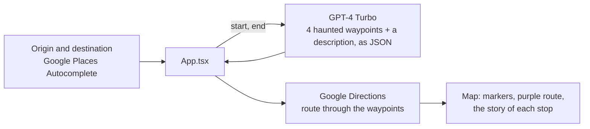

<div align="center">

# Cruel Maps

> *"It's not about the destination, it's about the journey."*

**A maps app that routes you past the creepiest places on the way.**<br>
Pick a start and an end; GPT-4 picks four haunted or eerie stops between them, and Google Maps
draws the route through them. Built in 24 hours at Hack&Roll 2024, in React Native with Expo.

[](https://github.com/sp4ce-cowboy/cruel-maps/blob/501a0f5e56b5742a4cb80d08beb7094a07a74495/App.tsx#L77-L199)
[](package.json)
[](https://github.com/sp4ce-cowboy/cruel-maps/blob/501a0f5e56b5742a4cb80d08beb7094a07a74495/App.tsx)
[](https://github.com/sp4ce-cowboy/cruel-maps/blob/501a0f5e56b5742a4cb80d08beb7094a07a74495/model.js#L7-L31)
[](https://github.com/sp4ce-cowboy/cruel-maps/blob/501a0f5e56b5742a4cb80d08beb7094a07a74495/App.tsx#L158-L172)

</div>

> [!NOTE]
> This consolidated README page was added by
> [Claude Opus 5.5](https://docs.anthropic.com/en/docs/claude-code) in Nov 2026 using my
> [agentic-repo-analysis](https://github.com/sp4ce-cowboy/agentic-workflows) skill, from the
> project's code, git history and Devpost entry. The project itself is from Jan 2024. The original
> README is in **[README-ORIGINAL.md](README-ORIGINAL.md)**; the team's original repo is
> [Anant1902/cruel-maps](https://github.com/Anant1902/cruel-maps).

## At a glance

| | |
|---|---|
| **What** | A route planner that makes every trip "exhilaratingly eerie": an LLM chooses spooky waypoints between two places in Singapore and explains them |
| **Context** | [Hack&Roll 2024](https://hacknroll.nushackers.org/), NUS Hackers' 24-hour hackathon, 20 – 21 Jan 2024 ([Devpost](https://devpost.com/software/cruel-maps)) |
| **Team** | [Anant Shanker](https://github.com/Anant1902), [Khaleelur Rahman](https://devpost.com/khaleelrrahman2002), [Rubesh Suresh](https://github.com/sp4ce-cowboy) and [Evelyn](https://devpost.com/evedaktyl) |
| **Stack** | React Native 0.73 with Expo SDK 50, TypeScript, react-native-maps, Google Places Autocomplete and Directions, the OpenAI Node SDK (GPT-4 Turbo, JSON output) |

## How it works


- **Input:** two autocomplete fields (Google Places) set the origin and destination, and the map
  camera animates to each.
- **Waypoints:** [`handler`](https://github.com/sp4ce-cowboy/cruel-maps/blob/501a0f5e56b5742a4cb80d08beb7094a07a74495/model.js#L7-L31)
  asks GPT-4 Turbo for four coordinates on the way that pass "spooky, eerie or haunted" places in
  Singapore, ordered from start to end to limit detours, plus a summary of the places. The prompt
  insists on a bare JSON object so the app can parse it.
- **Route:** `MapViewDirections` draws the driving route through the waypoints, fits the map to it,
  and the description appears in a card beneath. The button reads *Start (AT YOUR OWN RISK)*.

<br clear="right"/>



## Skills shown

| Skill | Where it shows (click the links for the code) | Docs |
|---|---|---|
| **Mobile development**<br> | One-screen app with hooks state, a map ref and camera animation: [`App.tsx`](https://github.com/sp4ce-cowboy/cruel-maps/blob/501a0f5e56b5742a4cb80d08beb7094a07a74495/App.tsx#L77-L199) | [Expo MapView](https://docs.expo.dev/versions/latest/sdk/map-view/) |
| **LLM integration**<br> | Prompting for structured JSON and parsing it into map coordinates: [`model.js`](https://github.com/sp4ce-cowboy/cruel-maps/blob/501a0f5e56b5742a4cb80d08beb7094a07a74495/model.js#L7-L31) | [Chat Completions](https://platform.openai.com/docs/api-reference/chat) |
| **Maps APIs** | Places Autocomplete and Directions with waypoints: [`InputAutocomplete`, `MapViewDirections`](https://github.com/sp4ce-cowboy/cruel-maps/blob/501a0f5e56b5742a4cb80d08beb7094a07a74495/App.tsx#L44-L172) | [react-native-maps-directions](https://www.npmjs.com/package/react-native-maps-directions) |
| **Hackathon delivery** | Idea to demo in 24 hours, after (in the team's words) "probably the hundredth idea" | |

## Coding stats

From git: 4 code commits over 20 – 21 Jan 2024, about 290 lines of app code (`App.tsx` and
`model.js`). The README came a week later.

## On our resumes

**Skills:** React Native · Expo · TypeScript · OpenAI API · prompt engineering · Google Maps Platform · hackathon

- Built a React Native and Expo app in a team of four in 24 hours (Hack&Roll 2024) that routes a trip through haunted places, combining GPT-4 Turbo with Google Maps Places and Directions.
- Prompted GPT-4 Turbo to return four ordered waypoints and a description as strict JSON, and parsed them into map markers and a multi-stop route with react-native-maps-directions.
- Built the map interface in TypeScript: place autocomplete for origin and destination, animated camera moves, a fitted route and a description card.

## Getting started

```sh
npm install
npx expo start
```

The app needs a Google Maps Platform key (Places and Directions) in `environments.ts` and an
OpenAI key in `model.js`.

<sub>This project later inspired [wanderminds](https://github.com/sp4ce-cowboy/wanderminds), an AI travel companion app.</sub>
